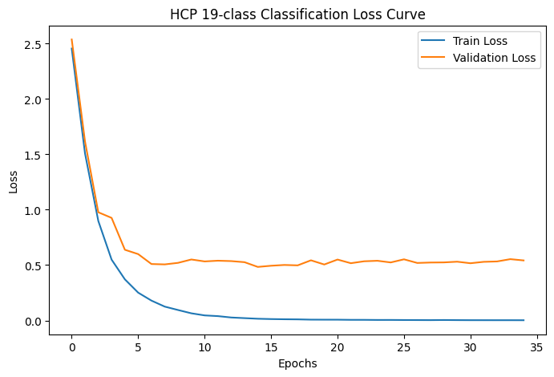
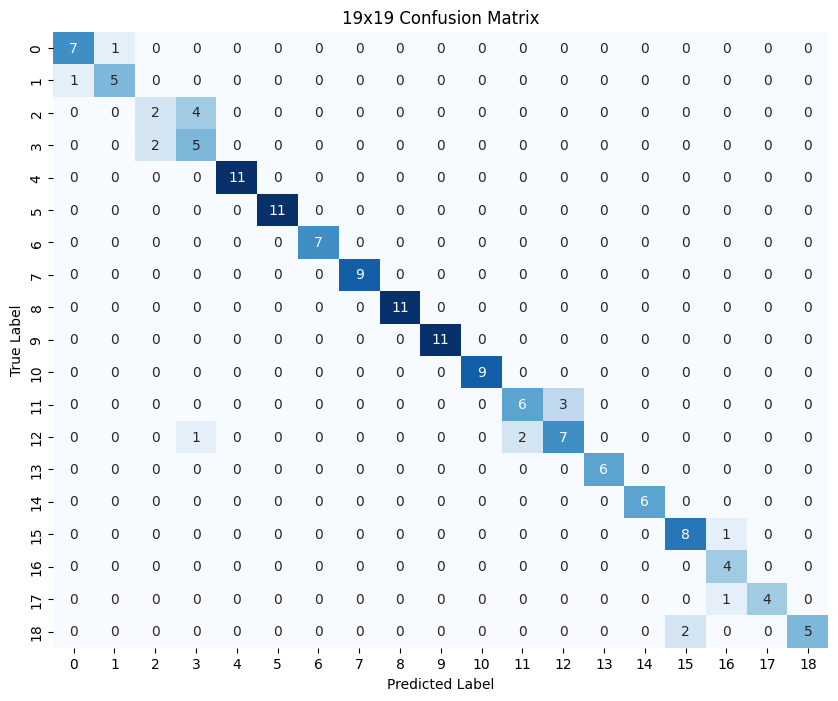
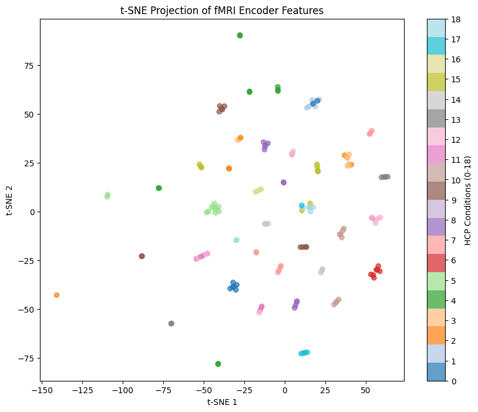
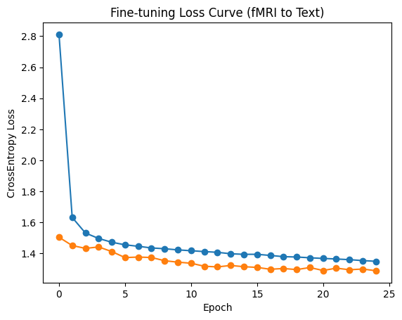
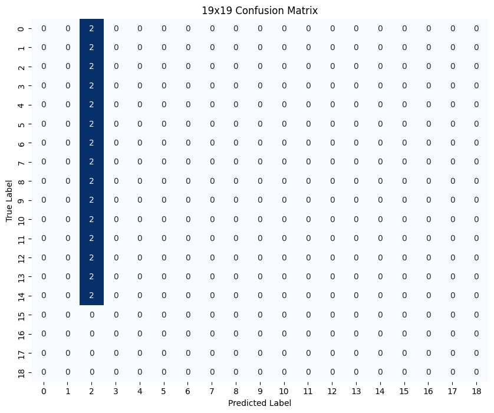

# 실험 과정과 결과

HCP task classification으로 학습한 fMRI encoder를 NSD caption decoding에 연결한 과정이다. 최종 노트북의 실행 결과를 중심으로 정리했으며, 실제로 기록하지 않은 중간 실험의 수치는 추가하지 않았다.

## 1. 데이터 흐름

전처리 실습과 모델 학습은 별도로 진행했다.

```text
raw HCP / NSD data → 전처리 → GLM → 직접 추출한 betamap → 추가 입력 테스트

제공된 HCP betamap → 19개 task condition 분류 → encoder 가중치 저장
                                                     ↓
제공된 NSD betamap + COCO 캡션 → encoder → Bridge → GPT-2 → 캡션 생성
```

### 전처리 실습

slice-timing correction, rigid-body motion correction, FWHM 6 mm spatial smoothing을 적용했다. 메모리 제약으로 구조영상 정합과 표준공간 정규화는 생략했다. 이후 GLM으로 반응 크기를 추정하고 마스크를 적용해 벡터로 저장했다.

| 항목 | HCP | NSD |
|---|---|---|
| 피험자 | 100206 | sub-01 |
| TR | 0.72초 | 1.6초 |
| 처리 run 수 | 12 | 15 |
| 저장 단위 | run 내 task condition | run 내 이미지 ID |
| 최종 배열 | `(30, 182453)` | `(133, 292796)` |

NSD에서는 같은 run의 동일 이미지를 하나의 GLM 조건으로 묶었다. 따라서 저장된 ID의 빈도는 원래 자극을 제시한 trial 수와 같지 않다.

## 2. HCP classification

제공된 betamap 1,520개에서 19개 task condition을 분류했다. 각 벡터를 길이 100,000으로 pooling하고 sample 단위로 train / validation / test를 80 / 10 / 10% 분할했다.

```text
betamap → Conv1d block × 4 → pooling → FC → feature vector (768) → classification head
```

Adam, learning rate `1e-4`, weight decay `1e-5`, batch size 64로 35 epochs 학습했다.

### 학습 곡선



| epoch | train loss | validation loss |
|---|---|---|
| 5 | 0.3713 | 0.6386 |
| 15 | 0.0155 | 0.4836 |
| 25 | 0.0046 | 0.5241 |
| 35 | 0.0020 | 0.5422 |

후반에는 train loss가 계속 감소한 반면 validation loss는 다시 증가했다. 아래 평가와 가중치 저장에는 마지막 epoch 모델을 사용했다.

### 분류 결과

**test Macro-F1: 0.8667**



숫자 label은 다음 순서다.

```text
0 fear      1 neut      2 loss      3 win       4 math
5 story     6 lf        7 lh        8 rf        9 rh
10 t        11 match    12 relation 13 mental   14 rnd
15 body     16 faces    17 places   18 tools
```



t-SNE는 test feature vector의 보조 시각화다. `perplexity=1`을 사용했으며, 분류 성능은 위 Macro-F1 및 confusion matrix로 확인한다.

## 3. NSD caption decoding

HCP classification head를 제거하고 저장한 encoder를 불러왔다. NSD betamap과 COCO 캡션 7,500쌍을 train 6,000 / validation 750 / test 750으로 나눴다. 각 sample에는 이미지의 캡션 중 하나를 dataset 생성 시 선택했다.

```text
betamap (100,000)
 → pretrained encoder
 → feature vector (768)
 → Bridge: Linear + Dropout
 → brain-prefix 3개 (각 768차원)
 → frozen GPT-2
 → 생성 캡션
```

GPT-2 가중치는 고정하고 encoder와 Bridge를 학습했다. 학습 시에는 prefix와 정답 캡션 embedding을 연결하며, 생성 시에는 prefix만 입력한다. 생성 설정은 `num_beams=3`, `do_sample=False`, 최대 30개 새 token이다.

### 설정 변경

초기 MLP에서 1D CNN으로 변경했고, 이후 encoder feature dimension을 256에서 768로 늘렸다. prefix는 4~16개를 시도한 뒤 최종 3개로 조정했다. prefix 증가에 따른 성능 향상이 크지 않은 반면 학습 시간이 늘어났기 때문이다.

이 과정은 설정 변경 이력이며, 이전 구성별 비교 수치는 별도로 남아 있지 않다.

### 학습 곡선



Adam, learning rate `1e-4`, batch size 64로 25 epochs 학습했다.

| epoch | train loss | validation loss |
|---|---|---|
| 5 | 1.4722 | 1.4121 |
| 10 | 1.4230 | 1.3438 |
| 15 | 1.3944 | 1.3147 |
| 20 | 1.3721 | 1.3091 |
| 25 | 1.3495 | 1.2887 |

### 실제 생성 예시

아래는 노트북에 출력된 test 첫 10개 중 여섯 예시다. 문장은 출력 원문이며, sample 번호도 노트북과 같다. COCO 캡션은 이미지에 대한 설명이지 피험자의 발화가 아니다.

| sample | reference | generated caption |
|---|---|---|
| 1 | several red ripe apples in two large wooden boxes | A large bowl of rice and a large bowl of noodles. |
| 2 | A woman sitting at a table with plates of food. | A woman is sitting on a bench with her hands on her hips. |
| 3 | Room with wood covered wall and floor with two beds. | A large room with a bed and a desk. |
| 4 | a green field that has a man with a kite | A man standing on a tree. |
| 6 | A seagull rests on a concrete wall, with the ocean and a lighthouse in the background. | A man is standing on a tree in the middle of the road. |
| 7 | A zebra is standing in a field and looking right at the camera. | A man is standing on a tree in the middle of the forest. |

sample 2와 3에서는 사람·앉기, 방·침대 등 겹치는 개념이 나타났다. 다만 장소나 사물, 개수는 달랐다. 다른 예시에서는 중심 대상 자체가 다르거나 `A man ... a tree`와 같은 표현이 반복되었다.

문장 생성까지의 연결은 구현했지만, 자연스러운 문장이 곧 이미지 내용의 정확한 복원을 의미하지는 않았다. 저장된 텍스트 평가값의 확인 사항은 [한계](limitations.md#캡션-평가)에 정리했다.

## 4. zero / random 입력

실제 betamap 대신 zero 벡터 하나와 `[0, 1)` 균등분포 random 벡터 세 개를 입력했다.

| 입력 | generated caption |
|---|---|
| zero | A man walks up to a tree and sees a tree. |
| random 1 | A man walks up to a tree with his hands on a tree. |
| random 2 | A man walks up to a tree with his hands on a tree. |
| random 3 | A man walks up to a tree with his hands on a tree. |

정보가 없는 입력에서도 문장이 생성됐고 random 입력에서는 동일 문장이 반복됐다. 이는 실제 입력의 생성 결과를 해석하기 위한 비교 자료다. 이 테스트만으로 모델이 실제 betamap을 전혀 사용하지 않는다고 결론 내리지는 않는다.

## 5. 직접 전처리한 data의 추가 입력

### HCP

01 노트북의 산출물을 분류 모델에 입력했을 때 예측이 한 class에 집중됐다.



### NSD

02 노트북의 산출물에서도 서로 다른 자극에 유사한 문장이 반복됐다.

| reference | generated caption |
|---|---|
| Skiers and snowboarders going down a run on a sunny day. | A man standing on a beach with his head covered in sand. |
| A pizza on a plate with a fork and knife. | A man is standing on a beach with his head covered in sand. |
| A large dog wearing an orange safety vest. | A man standing on a beach with his hands on his head. |
| A cat rclining in a red leather easy chair | A man standing on a beach with his head covered in sand. |

원문의 오타도 그대로 보존했다. 제공된 data와 직접 전처리한 data는 공간 정합, 마스크, voxel 구성과 값의 분포가 다를 수 있다. 길이를 100,000으로 맞추는 것만으로 이러한 차이가 해소되지는 않는다.

## 요약

- HCP classification에서는 sample 단위 분할 기준 test Macro-F1 0.8667을 기록했다.
- encoder와 Bridge를 학습하고 frozen GPT-2에서 캡션을 생성했다.
- 생성 결과에는 일부 개념 중첩과 함께 대상 불일치·반복이 나타났다.
- zero·random 및 직접 전처리한 입력의 결과를 함께 남겨 모델의 동작을 비교했다.

구현과 전체 출력: [03 HCP classification](../Notebooks/03_HCP_classification.ipynb) · [04 NSD caption decoding](../Notebooks/04_NSD_caption_decoding.ipynb)
