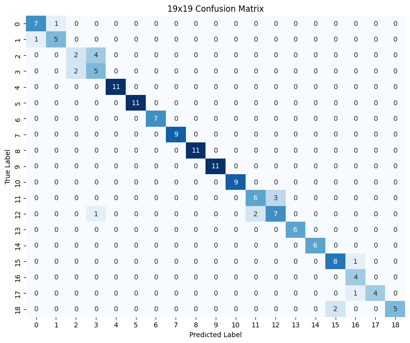
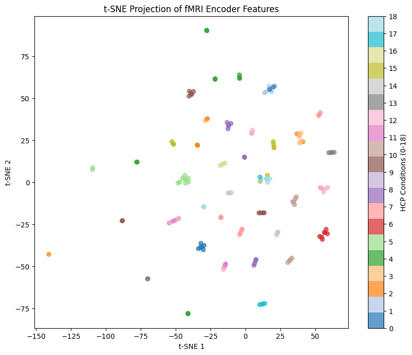
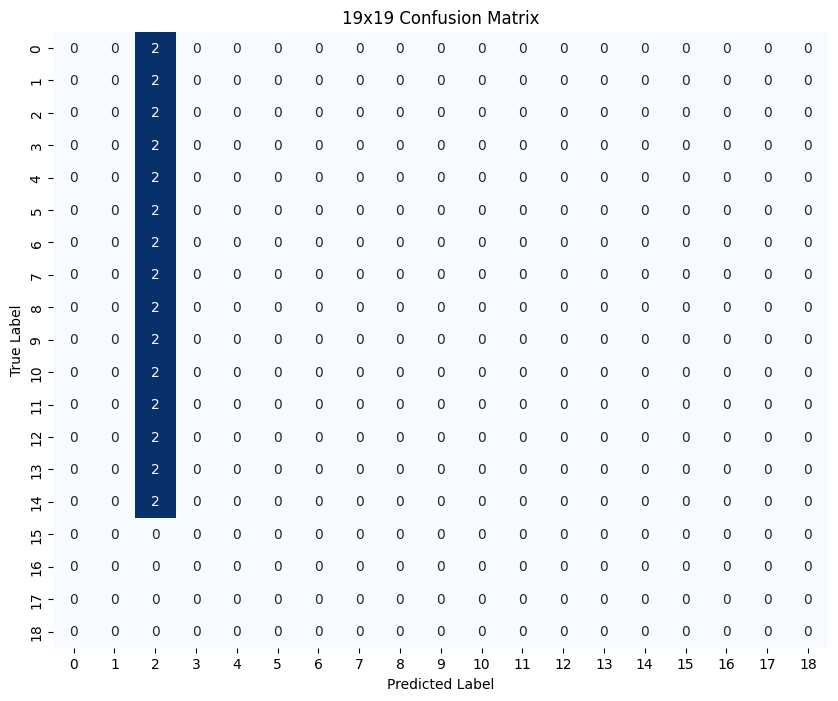

# HCP classification 결과

제공된 HCP betamap으로 19개 task condition을 분류했다. 모델 구조와 학습 과정은 [실험 기록](../../Docs/experiment_log.md#2-hcp-classification)에 정리했다.

## 1. Test 결과

**test Macro-F1: 0.8667**

1,520개 sample을 train / validation / test 8:1:1로 무작위 분할하고 마지막 epoch 모델을 평가했다.

### Confusion matrix

| label | task condition | label | task condition |
|---|---|---|---|
| 0 | fear | 10 | t |
| 1 | neut | 11 | match |
| 2 | loss | 12 | relation |
| 3 | win | 13 | mental |
| 4 | math | 14 | rnd |
| 5 | story | 15 | body |
| 6 | lf | 16 | faces |
| 7 | lh | 17 | places |
| 8 | rf | 18 | tools |
| 9 | rh | — | — |

### Encoder feature 시각화

test sample의 768차원 feature vector를 t-SNE로 시각화했다.

## 2. 직접 전처리한 HCP data의 ablation

직접 전처리한 betamap data(첫 번째 ipynb 파일 참조) 30개를 같은 길이로 pooling하고 학습된 분류 모델에 입력했다. 모두 같은 라벨로 분류되는 것으로 확인된다.

제공된 data로 평가했을 때와 달리 예측이 한 class에 집중됐다. 생략한 전처리 단계와 mask 차이를 가능한 원인으로 봤다.

---

[실험 과정](../../Docs/experiment_log.md) · [Caption Examples](../Caption_examples/example.md) · [03 HCP classification 노트북](../../Notebooks/03_HCP_classification.ipynb)
